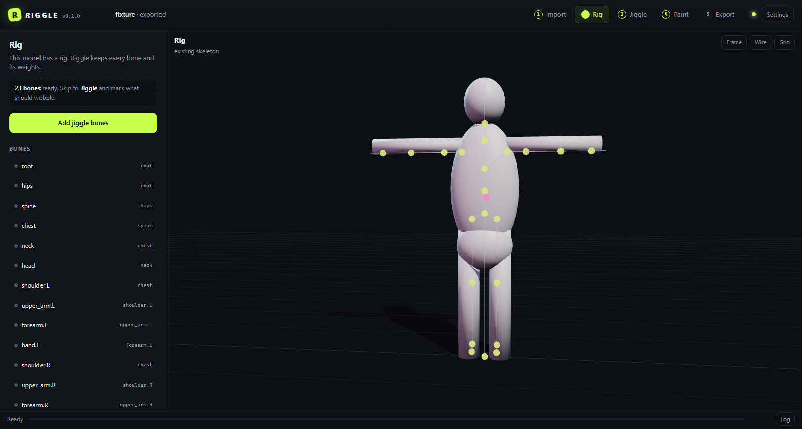
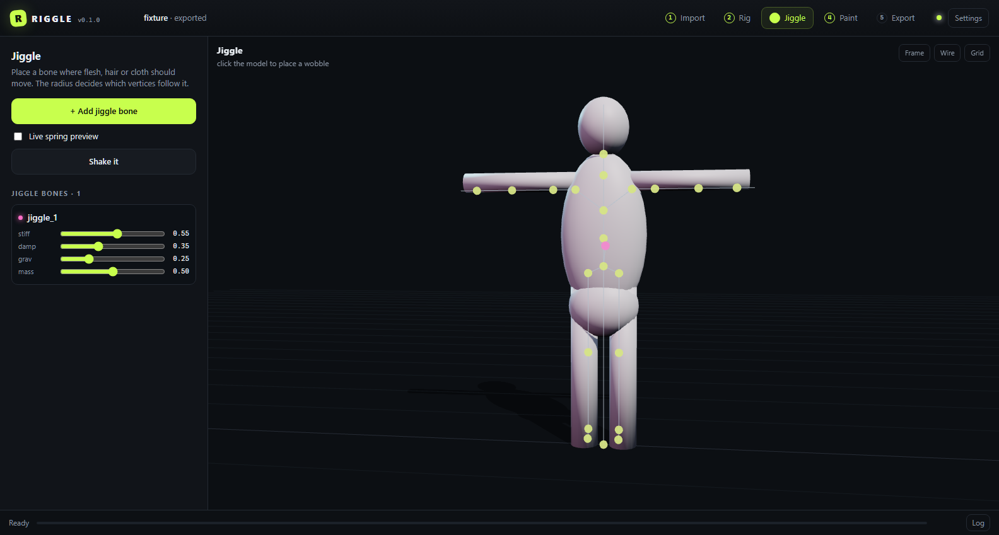
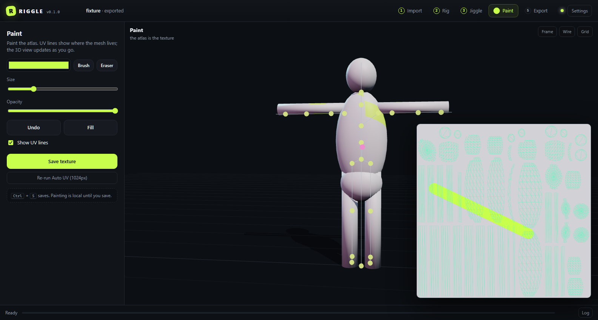

# Riggle

**Rig it, jiggle it, ship it.**

Riggle is a local, open-source character workbench for the part of Character Creator
you actually use: drop in a mesh, fit a skeleton, mark the bits that should wobble,
unwrap and paint one texture atlas, then export a rigged **GLB + FBX** with a spring
manifest. No model library, no account, no cloud.

Blender is the geometry engine. The browser is the UI. Everything runs on your machine.



## Requirements

- **Python 3.10+** (stdlib only — no pip install needed)
- **Blender 4.5+** (tested with Blender 5.2 from Steam). Riggle finds common install
  paths automatically; otherwise point it at `blender.exe` in **Settings**.
- A modern browser. Chromium/Edge are tested; Firefox should work, Safari is untested.

## Run

Windows: double-click **`START.bat`**.

Any OS:

```bash
python run.py
```

It starts on `http://127.0.0.1:8765/` and opens your browser. Use `--port 9000` to
change the port, `--no-browser` to stay put. `python run.py --version` prints the
version.

## The five steps

### 1. Import

Drop a **.blend, .fbx, .glb, .gltf, .obj, .stl, .ply, .usd** or **.usdz** file.
Riggle normalises the scene, puts the feet on the floor, and writes a project
folder. Your source file is copied, never modified.

### 2. Rig

A 22-joint humanoid skeleton is fitted to the model's bounding box. Drag any joint
in the viewport; children follow and the other side mirrors automatically. Hit
**Bind skeleton** to run Blender's automatic weights (with a nearest-bone fallback
when heat weighting fails).

Already rigged? Riggle keeps the existing skeleton and weights and skips straight
to jiggle authoring.

### 3. Jiggle

Click **+ Add jiggle bone**, then click the model where flesh, hair or cloth should
move. Pick the parent bone, weight radius and bone length. Each jiggle bone gets
four spring parameters:

| Parameter | What it does |
|---|---|
| `stiffness` | how hard it springs back |
| `damping` | how quickly it settles |
| `gravity` | how much it droops |
| `mass` | how heavy it feels |

**Live spring preview** animates the authored bones in the viewport; **Shake it**
kicks them. The weights are transferred from the surrounding body bones, so the
mesh actually deforms.



### 4. Paint

**Auto UV unwrap** packs the whole character into one atlas with Blender's smart
project + island packing, assigns it to every material, and writes a vector UV
layout. The atlas is docked beside the 3D view; brush strokes update the model
live. Brush, eraser, fill, opacity, undo, UV overlay and Ctrl+S are included.

Painting is local until you save (or export — Riggle saves dirty textures first).



### 5. Export

Choose any folder and a file name. You get:

```
MyHero.glb                 skinned mesh + skeleton + embedded texture
MyHero.fbx                 same rig for Blender, Unity or Unreal
textures/basecolor.png     the painted atlas
riggle.json                bones, jiggle tuning, UV settings
README.txt                 wiring notes for the engine
```

The same manifest is stored on the armature node in the GLB as the
`riggle_manifest` extra, and each jiggle bone carries `riggle_jiggle` and
`riggle_params` extras.

## Where things live

| What | Where |
|---|---|
| Projects | `~/RiggleProjects/<name>-<id>/` (`imports/`, `work/`, `logs/`) |
| Exports | the folder you choose |
| Config | `%LOCALAPPDATA%\Riggle\config.json` (Linux/macOS: `~/.config/Riggle/`) |
| Log | `%LOCALAPPDATA%\Riggle\riggle.log` and each project's `logs/riggle.log` |

Set `RIGGLE_DEBUG=1` for verbose server/job output. A project's `logs/jobs/`
folder keeps the Blender job JSON and result for every run.

## Jiggle manifest

`riggle.json` is deliberately engine-neutral:

```json
{
  "manifest_version": 1,
  "coordinate_system": "glTF Y-up",
  "jiggle_order": ["jiggle_breast.L"],
  "jiggle": {
    "jiggle_breast.L": {
      "parent": "chest",
      "head": [0.10, 1.24, 0.12],
      "tail": [0.10, 1.14, 0.17],
      "radius": 0.26,
      "stiffness": 0.55,
      "damping": 0.35,
      "gravity": 0.25,
      "mass": 0.5
    }
  }
}
```

Wiring it up:

- **three.js** — read the bone list and drive each bone with a damped spring
  (the preview in `web/js/viewport.js` is a working reference).
- **Unity** — add a Dynamic Bone / PhysBone component to the named transforms.
- **Unreal** — add AnimDynamics or a physics constraint to the named bones.
- **Blender** — import the FBX; bone names are preserved, so constraints map 1:1.

The mesh is skinned to the skeleton. Do not rename bones unless you update the
manifest too.

## How it works

```
browser (Three.js, canvas paint)
        │  HTTP + token, 127.0.0.1 only
        ▼
Python stdlib server  ──queue──►  headless Blender worker
        │                              (import, rig, weights, UV, export)
        ▼
project folder: imports/ work/ logs/
```

- **One Blender process at a time.** Jobs are queued, stream progress, and have a
  deadline. The UI never blocks on a stale process.
- **glTF coordinates everywhere in the app:** +X right, +Y up, +Z toward viewer.
  Conversion happens only at the Blender boundary.
- **Token-protected local server.** It binds `127.0.0.1`, mints a token at startup
  and requires it for API and media calls, so another browser tab cannot drive
  Blender.
- **Vendored Three.js 0.169.0.** No CDN, works offline.

## Tests

```bash
python -m unittest discover -s tests -p "test_*.py" -v
python tests/blender_smoke.py
```

The unit/API suite uses a deterministic fake Blender runner. The smoke test runs
the real pipeline (import → rig → jiggle → UV → export) through your installed
Blender. Set `RIGGLE_BLENDER` to test a specific executable.

## Known limits

- **Automatic weights** are Blender's heat solver, with a nearest-four-bone
  fallback. There is no manual weight painting yet.
- **One atlas.** Auto UV replaces the source UVs and material textures in the
  project copy (your original file is untouched). Multi-material models collapse
  to a single atlas.
- **Jiggle is authored, not baked.** The exported rig contains real bones and
  weights; the spring behaviour needs a runtime component in the target engine.
  The manifest and extras give it the numbers.
- **No animation baking.** Existing actions are not exported.
- **Humanoid preset only.** Non-humanoid meshes work, but you place the joints
  yourself.

## License

MIT © 2026 SenjuWoo. Three.js is MIT; see [THIRD_PARTY.md](THIRD_PARTY.md).
